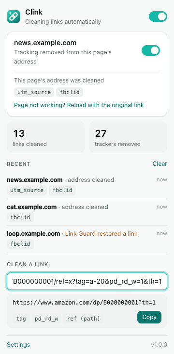
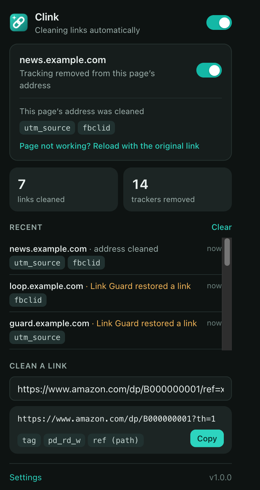

# Clink — clean links

[](https://github.com/iacompa/Clink/actions/workflows/ci.yml)
[](LICENSE)

Clink is a browser extension for **Chrome, Firefox and Safari** (macOS and iOS). It strips
tracking junk out of every link you open (`utm_source`, `fbclid`, `gclid`, `si`, `mc_eid`,
Amazon's `ref=`/`pd_rd_*`, and hundreds more) and skips click-tracking redirect pages
(`google.com/url`, `l.facebook.com`, …), **without breaking links**.

```
before  https://shop.example.com/sale?utm_source=newsletter&utm_campaign=bf&fbclid=IwAR2x…&item=9
after   https://shop.example.com/sale?item=9
```

<p align="center">
  
  &nbsp;
  
</p>

## How it keeps links working

Removing parameters is easy. Removing them *without ever landing on a broken page* is
what the design is built around:

1. **Only known trackers are removed.** Clink never strips "everything after the `?`". It
   removes parameters on a curated list (97 click/email trackers, 139 campaign tags,
   7 affiliate codes, plus rules for 33 specific sites). Anything that might matter is kept:
   search terms, product variants (`th=1`), timestamps (`t=42`), gift-article codes, invite codes.
2. **Some links are never touched:**
   - unsubscribe, email-preference and opt-in links (they need their IDs)
   - signed links: S3, Google Cloud, CloudFront, `sig=`/`signature=`
   - sign-in and checkout pages: Google, Microsoft, Apple, PayPal, Stripe, Shopify
   - marketing dashboards such as Google Analytics and campaign URL builders
   - `localhost`, `.test`, `.local` and private IPs
3. **Link Guard** (Chrome and Firefox) watches every navigation Clink cleaned. If the cleaned
   page fails to load (a 404 or similar error, or a redirect loop because the site insists
   on its tracker), Clink reopens the original link at once. It also remembers that site, so
   it never breaks there again. You can see and undo what it learned in Settings.
4. **You stay in control.** You can pause Clink per site, toggle each category (for
   example, keep affiliate codes so creators get credit), and the popup has a one-click
   *"Reload with the original link"* button.

## How it works

Clink cleans links in two layers, so it catches links no matter how they're opened:

| Layer | What it does | Catches |
|---|---|---|
| **Network** (`declarativeNetRequest`) | Rewrites the URL inside the browser *before the request is sent*, so the site never sees the tracker | typed or pasted URLs, links from other apps and email, new tabs, server redirects (email click-trackers) |
| **Page** (content script) | Rewrites `<a href>`s as pages load and again at click time, unwraps redirect wrappers, removes `ping=` beacons, cleans URLs you copy | in-page links, links whose href is swapped at click time (Gmail/Facebook style), links in shadow DOM, the clipboard |

Both layers are generated from **one rule list**, [`src/shared/rules.js`](src/shared/rules.js).
A test checks that the generated network rules agree with the page cleaner on every
test URL.

Privacy: Clink runs entirely in your browser. It has no analytics, sends no data anywhere,
and makes no network requests of its own. Its stats stay on your device.

## Install

You need [Node.js](https://nodejs.org) 22 or newer. Run this once:

```bash
npm install
```

```bash
npx playwright install chromium
```

(The second command downloads the headless browser used by the tests and the icon
renderer.) Then build:

```bash
npm run build
```

The build writes `dist/chrome`, `dist/firefox` and `dist/safari`, plus store-ready zips in `dist/`.

### Chrome (also Edge, Brave, Arc, Opera)

1. Open `chrome://extensions` and turn on **Developer mode** (top right).
2. Click **Load unpacked** and pick the `dist/chrome` folder.
3. Pin Clink from the puzzle-piece menu.

An unpacked extension stays installed across restarts. To publish, upload
`dist/clink-chrome-1.0.0.zip` to the Chrome Web Store developer dashboard.
Chrome 116 or newer is required.

### Firefox (desktop 140+, Android 142+)

- **To try it now:** open `about:debugging#/runtime/this-firefox`, click **Load Temporary
  Add-on…**, and pick `dist/firefox/manifest.json`. It stays until Firefox restarts.
- **To install it permanently:** release Firefox only installs signed add-ons. Sign it for
  yourself (free, unlisted) with API keys from
  [addons.mozilla.org → Developer Hub → API keys](https://addons.mozilla.org/developers/addon/api/key/):

  ```bash
  npx web-ext sign --source-dir dist/firefox --channel unlisted --api-key "$AMO_JWT_ISSUER" --api-secret "$AMO_JWT_SECRET"
  ```

  This gives you a signed `.xpi` in `web-ext-artifacts/`; drag it into Firefox. To publish
  publicly, upload `dist/clink-firefox-1.0.0.zip` to addons.mozilla.org.

### Safari (macOS and iOS)

You need Xcode. This builds the extension, wraps it in a Mac/iPhone app with Apple's
converter (creating `safari/` the first time), and compiles it:

```bash
npm run safari
```

Then, to run it on this Mac:

1. In Safari, go to **Settings → Advanced** and turn on **Show features for web developers**.
2. Go to **Settings → Developer** and turn on **Allow unsigned extensions**. Safari asks for
   your password, and the setting resets each time Safari quits.
3. Launch the app once to register the extension:

   ```bash
   open safari/build/Build/Products/Release/Clink.app
   ```

4. Go to **Settings → Extensions**, enable **Clink**, and choose **Always Allow on Every Website**.

To ship it through the App Store or put it on an iPhone, run `npm run safari -- --open`, set
your Team under *Signing & Capabilities* in Xcode, then use **Product → Archive**.
(`CLINK_BUNDLE_ID=com.you.Clink npm run safari -- --regenerate` sets your own bundle ID.)
Signing settings you make in Xcode are kept: later `npm run safari` runs only copy in the
newest extension files.

The converter prints a note that `persistent` isn't supported. That's expected and harmless:
iOS requires the explicit `"persistent": false`.

## Develop

```
src/
  shared/rules.js      ← every tracker, site rule, redirect wrapper and safety exception
  shared/cleaner.js    the URL cleaner (used by the page layer, popup and background)
  shared/settings.js   settings storage
  content.js           page layer
  background.js        network rules, Link Guard, badge, stats
  popup/ options/ ui/  interface
scripts/
  build.mjs            builds all three browsers; dnr.mjs turns rules.js into network rules
  safari.mjs           Safari Xcode project + build
  gen-icons.mjs        renders the icons from icon-svg.mjs
test/
  unit/                cleaner + network-rule tests (with a declarativeNetRequest simulator)
  e2e/                 real Chromium (Playwright) and the real installed Firefox (WebDriver BiDi)
```

| Command | What it does |
|---|---|
| `npm test` | unit tests: more than 90 must-clean and must-not-change URLs, plus a network-rule simulator |
| `npm run test:e2e` | builds, then drives real Chromium and Firefox through every feature (20 tests) |
| `npm run lint:firefox` | Mozilla's add-on linter |
| `npm run safari` | Safari Xcode project; compiles for macOS and the iOS Simulator |

**To add a tracker:** add it to the right list in `src/shared/rules.js`. Add a must-clean
URL (and, if it's risky, a must-not-change URL) to `test/unit/cleaner.test.mjs`. Then run
`npm test`. The network rules are regenerated from the same list on every build.

## Limitations

- **Safari has no Link Guard.** Safari doesn't give extensions the `webRequest` events Link
  Guard needs. Cleaning works the same, but if a site ever breaks, pause it from the popup.
  Clink's lists are deliberately conservative to make this rare.
- **Opaque short links** (`t.co`, `bit.ly`, email click-trackers) can't be unwrapped without
  visiting them. Clink cleans where they lead instead: the trackers are stripped from the
  redirect target before that page loads.
- **Corporate security scanners** (Outlook Safe Links, Proofpoint) are intentionally *not*
  bypassed.
- Firefox's own *Query Parameter Stripping* (in Strict tracking protection) works alongside
  Clink; Clink covers far more parameters and sites.

## Contributing

Bug reports and pull requests are welcome at
[github.com/iacompa/Clink](https://github.com/iacompa/Clink/issues). For a link Clink broke
or a tracker it missed, please include the full URL (with anything private removed).
Before sending a change, run `npm test` and `npm run test:e2e`. Every new tracker or site
rule needs a test URL. By contributing, you agree that your work is licensed under the
same terms as Clink.

## License

Copyright (C) 2026 IA COMPA

Clink is free software: you can redistribute it and/or modify it under the terms of the
GNU General Public License as published by the Free Software Foundation, either version 3
of the License, or (at your option) any later version.

Clink is distributed in the hope that it will be useful, but WITHOUT ANY WARRANTY; without
even the implied warranty of MERCHANTABILITY or FITNESS FOR A PARTICULAR PURPOSE. See the
[GNU General Public License](LICENSE) for more details.

## References

- [Chrome `declarativeNetRequest`](https://developer.chrome.com/docs/extensions/reference/api/declarativeNetRequest)
- [MDN: `declarativeNetRequest` URL transforms](https://developer.mozilla.org/en-US/docs/Mozilla/Add-ons/WebExtensions/API/declarativeNetRequest/URLTransform)
- [MDN: `background` in manifest.json](https://developer.mozilla.org/en-US/docs/Mozilla/Add-ons/WebExtensions/manifest.json/background)
- [Apple: Converting a web extension for Safari](https://developer.apple.com/documentation/safariservices/converting-a-web-extension-for-safari)
